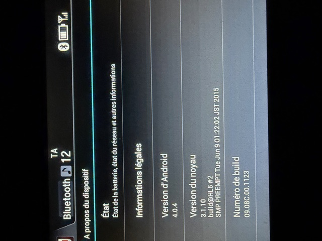
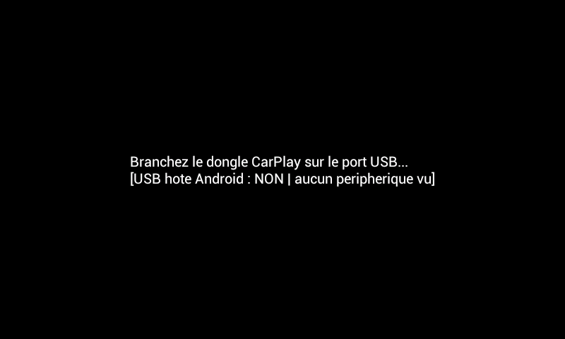
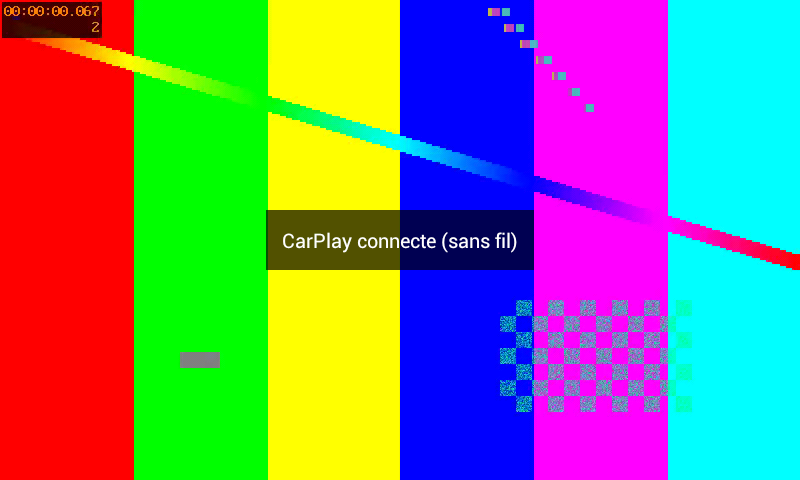
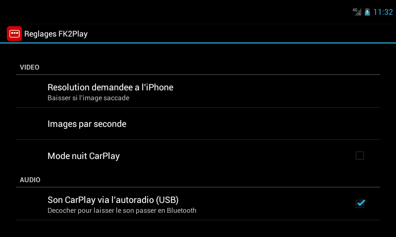

# Modes d'emploi FK2Play 1.1-beta

> [!WARNING]
> **Bêta, jamais testée en voiture.** Vos retours sont nécessaires : [rapport de test](../../../issues/new?template=rapport-de-test.yml).

| Guide | Pour qui |
|---|---|
| [Mode_emploi_FK2Play_RC3.pdf](Mode_emploi_FK2Play_RC3.pdf) | Honda Connect **RC3** (build `09.08C.00.xxxx`) : guide illustré pas à pas, 9 pages. |
| [Mode_emploi_FK2Play_toutes_versions.pdf](Mode_emploi_FK2Play_toutes_versions.pdf) | Toutes versions (RC3 à RC8), avec les chemins RC7/RC8. |

## Résumé en 8 étapes (RC3 à RC6.1)

1. **Vérifier la version** : HOME → Réglages → Android → À propos du dispositif → *Numéro de build*.

   

2. **Honda Permissions** (S_Mike, forum XDA, non fourni ici) : le renommer `HondaAppCenter_A1.apk`, le copier à la racine d'une clé USB FAT32, l'installer avec l'installateur d'APK du Honda Connect. En cas d'échec : réinitialisation usine d'Android puis nouvel essai.
3. **Débloquer** : Honda Permissions → *Allowed Installations* → appui long sur `HondaAppCenter_A1.apk` → crayon → *Sig digest sha256* = `PREINSTALL`.
4. **Installer FK2Play** : copier `HondaAppCenter_A1.apk` de la [release](../../../releases) sur la clé (seul fichier) et l'installer de la même façon.
5. **Droits** : Honda Permissions → *Process Controls* → `+` : Process/Package `com.fk2play`, Auth Type `THIRD_PARTY`, App Type `NAVI`, SoundOut / SoundInterrupt / SoundInterruptMute / LastMode **ON**, ProcessKillTarget **OFF**.
6. **Test sans dongle** : lancer FK2Play et lire la ligne de diagnostic.

   

7. **Brancher le dongle** directement (pas de hub), accepter l'accès USB. `Dongle initialise...` = réussite.
8. **iPhone** : Bluetooth → appareil du dongle → *Utiliser CarPlay*.

   

Réglages (touche MENU) : résolution, images/s, mode nuit, son USB/Bluetooth, micro, Wi-Fi 5 / 2,4 GHz.

**À ne pas faire** : mettre à jour le Honda Connect vers RC7/RC8 avant d'avoir tout installé (ou alors sans réinitialisation usine), mettre à jour les applis Honda ou le firmware du dongle, utiliser un hub USB.
